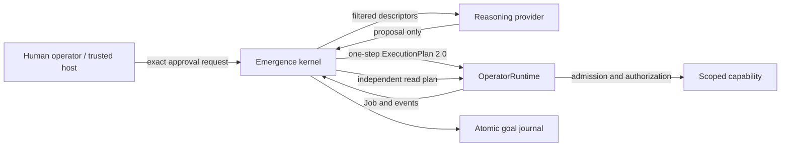

# Veil emergence kernel: local foundation

## Scope and reproduction

This is a bounded application layer in `src/emergence`. It uses the existing
`OperatorRuntime`, capability descriptors, ExecutionPlan 2.0 admission,
authorization, Job outcomes, and Job events. It does not change the locked
runtime contracts or any Experiment 005 source or evidence.

```sh
npm run typecheck
npx tsc --project tsconfig.test.json
node --test --test-isolation=none .tmp/test-build/test/emergence-kernel.test.js
node --import tsx tools/emergence-demo.mjs --approve-fixture-writes
```

Without `--approve-fixture-writes`, the demo stops at the first approval
request and prints its journal path. The flag is an explicit local operator
grant for the pinned temporary fixture. The demo does not call a model, use a
shell capability, access the network, or edit a repository file.

## Foundation audit and gap analysis

| Concern | Existing foundation | Gap addressed here / remaining gap |
| --- | --- | --- |
| Execution | `ExecutionPlan`, validation, `OperatorRuntime.executePlan`, Job steps and outcomes | Bounded repeated decisions with observed feedback. Veil remains the only executor. |
| Discovery | Detached `listCapabilities()` descriptors with risk and shallow input fields | Per-worker filtered discovery and peer directory. Descriptors do not express output shapes or resource-specific permissions. |
| Governance | Per-step `ExecutionAuthorizer`, caller context, plan admission, v2 governed value capture | Host-owned worker scopes, exact-proposal authorization and approval gate. An authenticated host must implement the gate in production. |
| Reasoning | Planners, strategies, router, OpenAI-compatible planner; external-reasoner host protocol | `ReasoningProvider` accepts state and proposes an action. The demo uses an offline deterministic policy. No model adapter or token accounting is bundled. |
| Persistence | Optional SQLite JobStore and retained Job events | Atomic JSON goal journal with decisions, delegation, approvals and verification evidence. Single writer only; no multi-process lease or transactional tie to effects. |
| Observability | Job events, runtime event bus, API routes and starter UI panels | Typed goal state and sequenced journal events. No operational UI is built because the existing UI components are plan/job examples, while the separate Veil UI lab has its own design scope. |
| Development tools | TypeScript, `tsx`, Node test runner, Playwright, MCP SDK, SQLite | Reused TypeScript and Node tools. No additional orchestration or memory package was necessary for this narrow loop. MCP can supply capabilities through its existing adapter. |

Experiment 004 showed governed coding with constrained capabilities, but its
task-specific agent and fixtures are not a general autonomous operating loop.
Experiment 005 Phase 3 v1.2 recorded 4/12 control and 1/12 treatment shared
objective completions; greater peer visibility and communication did not
establish better coordination. Its study did not meet the three-contributor
emergence criterion. Candidate 002 of Phase 4 is an offline implementation
candidate, with no live model trial and a recorded no-go pending independent
gates. None of those results proves general autonomy or scientific emergence.

## Architecture



The kernel repeats **discover → reason → propose → authorize → execute →
observe → adapt**. The host supplies the goal, fixed worker roster, budget,
policy, and read-only verification specification. The reasoner sees passive
descriptors and prior journal events; it never receives the runtime, caller
credentials, approval gate, or capability implementation. Its proposals are
checked against the active worker's allowlist. Every operation reaches Veil as
a single-step plan. For writes and destructive operations, the kernel stops
and persists an exact request. A trusted host authenticates the operator and
passes the request through `approvalGate`; Veil then receives a narrowly
matching authorizer for that action. Additional host policy can still deny it.

Workers are a fixed roster. A worker sees peers' permitted capability names
and can propose a bounded delegation with a capped evidence message. The
kernel records the reason, peer inventory, message and return. Workers cannot
create workers or change their own scopes. The coordinator's local policy
selects diagnostic and repair workers from observed events; the kernel itself
contains no software-repair sequence.

The demo creates a temporary calculator and test module. The diagnostic worker
observes `{passed:false}` and reads source. The repair worker proposes a patch
whose exact-match precondition fails; it then uses the observed source to
revise the patch. The verifier independently runs the pinned test capability
through Veil and compares its result with the host-owned `{passed:true}`
criterion. A completed Veil job alone never marks the goal verified.

## State and UI integration contract

`EmergenceState` in `src/emergence/types.ts` is the read model. The local
`src/emergence/index.ts` barrel exposes the typed integration surface without
changing the frozen package root. The state contains the
goal, status, budget, counters, queue, approval requests, verification rule,
and ordered events. Each event has `sequence`, `at`, `type`, optional `worker`,
and typed `data` at the TypeScript boundary. `FileJournal.load(id)` returns
the snapshot; a UI adapter can poll it or tail changes. Useful panels are:

| Panel | Fields / events |
| --- | --- |
| Goals and workers | `goal`, `status`, `queue`, `work.delegated`, `work.returned` |
| Capabilities | `capabilities.discovered`, `availableCapabilities`, worker roster |
| Plans and evidence | `reasoning.decision`, `execution.started`, `execution.completed`, `execution.failed`, nested Veil Job events |
| Approval | `approval.requested`, request ID and exact input; `approval.granted`, approver |
| Outcome and usage | `verification.completed`, `goal.completed` or `goal.failed`, decision/job/delegation counters and elapsed time |

An HTTP integration should expose read-only `GET /goals/:id` and event paging
by sequence. `POST /goals/:id/approvals/:requestId` belongs in a trusted,
authenticated host and must call `grantApproval` with the authenticated
identity. The endpoint should use a compare-and-swap or lease before enabling
concurrent operators. Do not expose `approvalGate` or raw journal writes to a
browser.

## Limits and next steps

### Local verification record (2026-10-18)

Type checking and the four focused kernel tests passed. The demo finished
`verified` with 9 decisions, 5 Veil jobs and 2 delegations; its journal shows
one failed patch and a later successful patch. `npm run check` reached the
root test stage, where 27 test files passed and the two existing external
reasoner files failed because this sandbox rejects their nested process
creation. `npm run verify:package` built the package, then its subprocess
returned empty JSON to the verifier. `npm run quality -- --base HEAD` reported
the expected new source/test growth and review-required governance references
in the new kernel/demo: kernel calls are to Veil's `executePlan` or the local
method that wraps it; the demo dynamically imports only its newly created,
pinned temporary fixture modules. No verification control or frozen source
file was edited. These quality findings need maintainer review before a
release.

### Limitations

The journal has one process writer and atomic file replacement, but no durable
transaction shared with Veil effects. An unmatched `execution.started` after
restart ends the goal as uncertain; an operator must inspect the external
effect before trying a new goal. There is no automatic replay of completed
mutations. A process that hangs inside a capability still needs that
capability's own timeout middleware. The current budgets cover decisions,
Veil jobs, delegations, proposal bytes and elapsed time, not model tokens or money. A real
model provider must be configured explicitly and enforce its own token and
cost reservations before calls; no such provider is enabled here.

Next: add a SQLite goal store with leases and an outbox for action receipts;
add capability-specific timeouts and effect reconciliation; expose an
authenticated read/event API; adapt an opt-in local model provider with
strict schema parsing and budget accounting; evaluate varied tasks and worker
rosters. Only after these gates should coordination quality be studied against
baselines. This demonstration is an engineering observation of one useful
bounded workflow, not evidence of scientific emergence or open-ended autonomy.

## v0.2: unscripted provider interface and recovery

The kernel now persists the active work item before asking a reasoner for its
next action. `run(id, decisionSlice)` can yield a still-running goal at a
specified decision boundary; another kernel instance can load the journal and
continue. A recorded successful or failed Veil job remains evidence for the
next decision. A started job with no outcome still fails closed as uncertain:
replaying a possibly completed external effect would be unsafe. A granted
approval with an already recorded outcome is not executed again.

`ReasoningProvider` accepts a detached goal, worker, scoped capability
catalogue, peer catalogue, ordered events, structured memory and remaining
budget. It returns one action; the kernel checks size, shape, worker scope and
input fields before creating a one-step ExecutionPlan. Delegation only changes
which preconfigured worker receives the task. Its authority stays fixed in the
worker roster and Veil's caller/authorizer checks. Read capabilities are the
only actions that can run without human approval in this version. The
independent host-owned verification specification runs through Veil even when
the provider proposes `finish`.

`FileJournal` stores observations, attempts, failures, capability information,
provider interpretations and verification evidence with provenance. Veil job
results are marked `veil`; the discovered catalogue and verification verdict
are `host`; decisions are `model` (this label also covers deterministic test
providers). Raw events remain available so interpretations can be checked
against the evidence they cite. The journal has one-writer atomic snapshots,
not concurrent leases or a transaction shared with a capability's external
side effect.

The new OpenAI-compatible chat adapter follows the repository's existing
chat-completions integration pattern. Construction requires an explicit
`authorized: true`, endpoint, model, API key, token ceiling, timeout and price
rates; no live call is made by the demo or tests. It reserves conservative
input/output token and cost room before transport, requests one JSON proposal,
records reported usage, and leaves execution to the kernel. The kernel also
caps model calls, decisions, jobs, delegations, elapsed time, cumulative job
execution time, proposal bytes, reported tokens and reported cost. A capability
that never returns can exceed the cumulative time cap; cancellation must be
implemented inside that capability or its host. Token reservations are an
estimate and provider billing metadata must be checked independently for
production accounting.

### Decision audit

| Decision source | Actual selection | Interpretation |
| --- | --- | --- |
| Original `RepairReasoner` | Hardcoded coordinator → diagnostic → repair order; hardcoded test/read/patch names, exact addition expressions and retry expression | Scripted fixture policy. Its nine decisions do not establish generalization. |
| Kernel | Filters capabilities, enforces budgets and approvals, delegates to fixed scopes, verifies with host expected value | Host governance, not reasoning. |
| New deterministic test provider | Generic option-discovery, attempt, retry and peer-scope policy; task candidate values arrive only from Veil observations | Provider-selected paths across three independent fixtures, but still a coded policy. |
| OpenAI-compatible adapter | Would select one action from contextual evidence when explicitly enabled | Protocol and budget path tested with a fake transport; no real model-selected result claimed. |

### Offline evaluation

Reproduce with:

```sh
npx tsc --project tsconfig.test.json
node --test --test-isolation=none .tmp/test-build/test/emergence-kernel.test.js .tmp/test-build/test/emergence-generalization.test.js .tmp/test-build/test/emergence-provider.test.js
```

The three new task fixtures have separate data and failure modes: an expired
candidate requiring another option, a transient capability failure requiring a
retry, and an option that only a differently scoped peer can try. The generic
test provider has no task-specific candidate values or outcome expectations.
All three reached `verified` through a separate read capability; the first two
made two attempts, and the third made one attempt and one delegation. A fourth
test stopped after two decisions, reloaded the journal through a new kernel,
and completed with exactly two total attempts: the recorded failed attempt was
not repeated. A separate approved-write test paused immediately after a
successful source patch, reloaded the journal, and verified that the patch
capability completed exactly once after resume. The malformed-input test proves rejection before any Veil job.
The adapter test proves opt-in validation, pre-call budget admission, response
parsing and usage accounting without network access.

These fixtures measure reusable control flow and recovery; they do not prove
that an LLM can solve arbitrary new goals. A live model study remains
explicitly opt-in and needs authorized credentials, task sampling and an
independent success audit. The original demo remains a scripted baseline.

### Verification record (2026-10-18)

Focused emergence tests passed (11 tests). `npm run check` passed type checking and 29 of
31 test files, then stopped at the two external-reasoner test files in this
sandbox. The same two files failed before this change, as recorded above; their
nested-process behavior is incompatible with this sandbox. `npm run
verify:package` compiled the package but its consumer subprocess returned
empty output and `tools/verify-package.mjs` failed to parse it. `npm run quality
-- --base 0ae46ff` reported review required for the changed test files and the
existing governance scanner findings in the demo and kernel. No frozen
research artifact, Veil runtime contract, package root export, or
verification control was changed.
